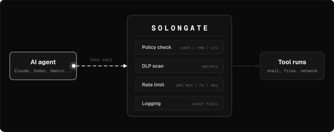
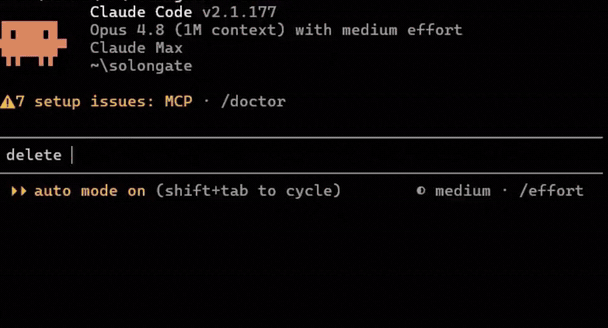
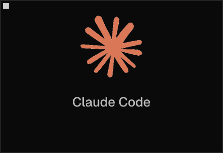
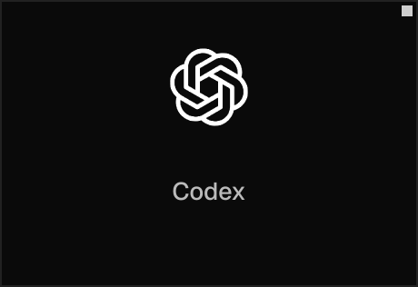
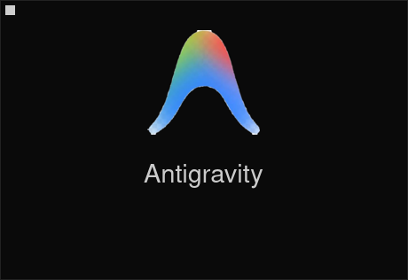
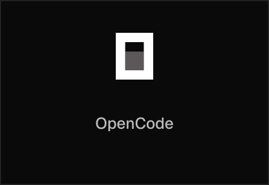
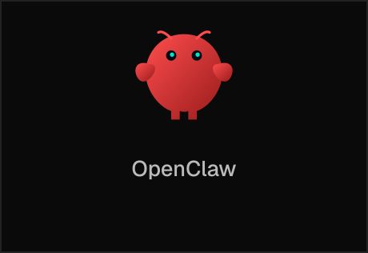
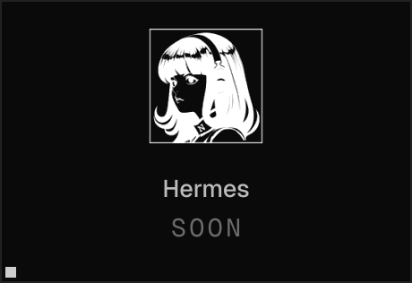
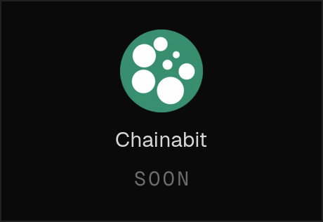
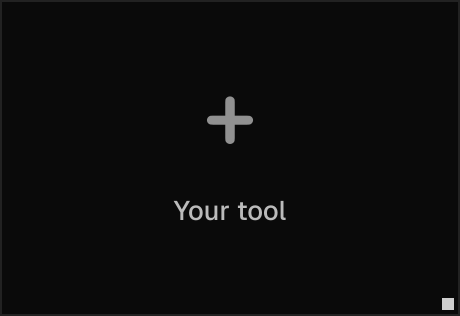

<div align="center">
  
</div>

<p align="center">
  <a href="https://github.com/solongate/agent-security/actions/workflows/ci.yml"></a>
  <a href="https://github.com/solongate/agent-security/actions/workflows/codeql.yml"></a>
  <a href="https://github.com/solongate/agent-security/releases"></a>
  <a href="LICENSE"></a>
  <a href="https://go.dev"></a>
  <a href="https://nodejs.org"></a>
</p>

<p align="center">
  <a href="https://www.bestpractices.dev/en/projects/15333/baseline-1"></a>
</p>

<p align="center">
  <a href="CONTRIBUTING.md"><b>Contributing</b></a> ·
  <a href="SECURITY.md"><b>Security</b></a>
</p>

---

**SolonGate Agent Security** is SolonGate's open source, local first security
gateway for AI coding agents. It checks tool calls against your policies before
they run, with secret detection, rate limits and a local audit trail.

This repository is the Agent Security gateway. The rest of the portfolio is at
[solongate.com](https://solongate.com).

Everything stays on the machine. The policy is a file, the audit trail is a
file, and the guard makes no network calls. No account, no telemetry.

That last one used to read "contains no code that can open a socket", which
is true of the guard's own source and not of the binary: it links OPA, which
brings `net/http` and a `http.send` builtin along with it. Nothing calls
them, and "makes no calls" is the claim that survives reading the symbol
table.

Agents: **Claude Code**, **Codex**, **OpenCode**, **Antigravity**.

<div align="center">
  
</div>

## Install

```bash
git clone https://github.com/solongate/agent-security.git
cd agent-security
./scripts/shell/install.sh
```

Then open a new terminal: hooks load when a session starts, so an already open
one is not guarded yet.

## Updates

```bash
solongate update          # move this checkout and reinstall from it
solongate range           # how far an update is allowed to move
solongate range short     # every commit on the branch
solongate range long      # tagged releases only  (the default)
```

**long** takes only tagged releases: somebody decided a state was worth naming
and the release job agreed. **short** takes whatever is on the branch, so a fix
reaches you the day it lands and so does whatever the next commit fixes. Both
are reasonable, for different people. The default is the cautious one, and the
TUI shows which one this machine is on under Settings.

The installer refuses to run from an agent, by design.

## What it looks like when it fires

A real Claude Code session: the agent reaches for a `.env`, the guard refuses it,
and the agent says so rather than quietly working around it.

<div align="center">
  
</div>

## What it enforces

| Layer | What it does |
| --- | --- |
| **Policy rules** | Allow or deny by path, command, filename or URL, scoped to READ, WRITE, EXECUTE or NETWORK. |
| **DLP** | 70 built in secret patterns plus your own, in four modes: `off`, `detect`, `redact`, `block`. |
| **Egress** | In block mode, refuses an upload whose file holds a secret, which pattern matching on the call alone cannot see. |
| **Rate limits** | A cap per minute, hour or day. |
| **The prompt** | A shim masks the outbound request body on Claude Code, which no tool call hook can reach. |
| **Tamper protection** | The guard's own state is unreachable from a tool call, and a policy in a repository cannot switch it off. |
| **Protected paths** | A path the OS itself refuses the agent, rather than a rule matched against the words in a tool call. |

Every decision lands in `~/.solongate/local-logs/solongate-audit.jsonl`, owner
only, one JSON object per line.

## Protected paths

Every layer above reads the strings in a tool call. That stops `rm game.c`. It
does not stop a script the agent writes and then runs, a path assembled at
runtime, or a program the agent compiles that calls `unlink` itself, and no
amount of pattern-adding closes that: the ways to name a file without typing
its name do not run out.

So a protected path is handed to the operating system.

```bash
solongate protect ~/game/game.c   # lock it, and say what the lock is worth
solongate protect list            # what is actually holding each path, read from disk
solongate run -- claude           # start the agent with those paths out of reach
```

`protect` puts a permanent lock on the file: `chflags uchg` on macOS, an
`icacls` deny plus an OWNER_RIGHTS ACE on Windows, `chattr +i` on Linux. The
first two need no privilege. Linux has no unprivileged equivalent, so it asks
for one `sudo chattr +i`, shows the exact command first, and falls back to
`chmod 0444` if you decline. That fallback stops the write and does not stop
`rm`, and `protect list` says so rather than printing the word "protected".

`run` is the other half, and the only command that changes what SolonGate is.
Everywhere else SolonGate is a child of the agent, answering questions about
calls the agent chose to declare. Started this way the confinement goes on
before the agent's first instruction, every process it starts inherits it, and
nothing it runs can remove it. Linux uses Landlock, macOS uses Seatbelt,
Windows uses a run-scoped deny. `solongate run --explain` says what each
actually gets and what it does not.

Measured on Linux with one file protected: `cat`, `rm`, `find -delete`,
`os.unlink`, `open(..., 'w')`, a script written to `/tmp` and run, and a C
program compiled on the spot all succeed when the agent is started normally and
all fail inside `solongate run`. Reading `/etc` and writing to `/tmp` keep
working.

What does NOT keep working, and this line used to claim it did: making a new
directory, or listing one, anywhere on the path down to a protected file.
Landlock has no deny rule, so protecting `/home/you/game/game.c` is written
as a grant on every sibling at every level above it, and a directory that
was walked through grants nothing on itself. `ls /`, `ls ~` and
`mkdir ~/anything` are refused for as long as the agent runs. `solongate
sandbox` has none of that cost, because an allow-list is the shape Landlock
actually is.

`solongate protect require-sandbox on` refuses every call from an agent that
was not started this way. It fails closed, so it is off until you turn it on.

## The closed box

A protected path protects what you remembered to name. That list never has
`~/.ssh` on it, or a sibling customer's repository, or the credentials of a
tool you installed last month, and those are what an agent reaching too far
actually finds.

So the other direction: name the one directory the agent may work in, and
everything else stops existing.

```bash
solongate sandbox list            # the boxes this machine has, and their ids
solongate sandbox 001 claude      # start the agent inside box 001
solongate sandbox --explain 001   # everything that is in that box
```

Boxes are made in the TUI's **Sandbox** section. Each gets an id from `001`,
and deleting one frees its id for the next, the number names a slot, not a
history, because it is something you type every time you start an agent.
`sandbox 1 claude` and `sandbox 001 claude` are the same box.

Inside, the agent's root is a tmpfs holding only the project at
`/workspace`, its own program read-only at `/opt/agent`, a read-only
runtime, a private `/proc` and a `/dev` with six nodes. `$HOME`,
`/etc/passwd`, `/root`, `/var` and every other project are not refused,
they are not there. `ls /` returns eleven entries and every one was chosen.
`HOME` points inside the project, so whatever the agent keeps is next to the
code it kept it about.

Measured on Linux, kernel 7.2.4, with two boxes over one directory: the
project reads and writes, binaries run, names resolve; `/home`, `$HOME`,
`/etc/passwd`, `/root`, `/var`, `/mnt` and the host's `/tmp` are all absent;
a script written in the project and run cannot reach out of it; only the
box's own processes are visible.

**The network is each box's own choice**, and it is the one hole that is not
a filesystem hole. On, the agent can reach its model and what leaves over
the wire is the DLP and egress layers' job, they read content, which a
mount namespace cannot. Off, nothing leaves at all and the agent is useful
only for work that needs no model.

It is built with [bubblewrap](https://github.com/containers/bubblewrap), so
`bwrap` has to be installed. A missing one is a refusal naming the package
rather than a fall back to `solongate run`: a box that quietly became a
permission layer would claim more than it does. Linux only, macOS and
Windows have no namespaces and refuse for the same reason.

### `run` or `sandbox`

| | `run` | `sandbox` |
| --- | --- | --- |
| What it is | a permission layer over this machine | a new root |
| Outside the project | refused | not there |
| `ls /` | the whole machine | eleven chosen entries |
| Protects | the paths you named | everything you did not |
| Network | always | per box |
| Platforms | Linux, macOS, Windows | Linux |

## The CLI

```
solongate              the TUI: policies, audit, settings
solongate policy       list, create and edit the policy
solongate dlp          secret detection
solongate ratelimit    the rate limit
solongate protect      paths the agent may not touch
solongate sandbox      start an agent in a closed box: the project, and nothing else
solongate run          start an agent inside OS-level confinement
solongate audit        browse the audit trail
solongate watch        live tail tool calls
solongate trace        what the guard saw in this directory
solongate doctor       health check
solongate repair       restore the guard, hooks and settings
solongate update       pull the newest version and reinstall
```

Most of these read or change a security posture, so they require a real
terminal on both stdin and stdout, and the guard refuses a tool call that
invokes them. Two are not gated that way:

- `run` is exempt on purpose. It changes nothing: it starts a process with
  MORE restriction than the caller had, never less, so the worst an agent
  achieves by invoking it is confining itself. Gating it broke the case the
  feature exists for, the shell shim launches the agent through `solongate
  run`, so the safe path became unavailable from scripts, CI and any IDE that
  spawns the agent itself. `run --explain` IS gated, because it prints the
  whole protected list where a refusal only ever names the path that was
  attempted.
- `update` is exempt because it re-runs the installer, which needs the
  terminal the installer writes to. It is the higher-leverage of the two,
  it moves the checkout and reinstalls the guard, the hooks and the client
  registrations, so it does not rest on this gate alone: the tamper layer
  refuses any tool call whose command names the CLI, `update` included.

`solongate --help` is the full tree of what is documented here; `tui`,
`stats` and a few flags exist without appearing in it.

## Supported agents

<table cellspacing="0" cellpadding="0" border="0" align="center">
  <tr>
    <td><a href="https://claude.com/claude-code"></a></td>
    <td><a href="https://openai.com/codex"></a></td>
    <td><a href="https://antigravity.google"></a></td>
    <td><a href="https://opencode.ai"></a></td>
  </tr>
  <tr>
    <td><a href="https://openclaw.ai"></a></td>
    <td><a href="https://hermes.nousresearch.com"></a></td>
    <td><a href="https://chainabit.com"></a></td>
    <td><a href="https://github.com/solongate/agent-security/issues"></a></td>
  </tr>
</table>

## Contributing

Go 1.26 and Node 22+.

```bash
pnpm install
pnpm build
```

There are two implementations of the guard, in Go and in bundled JavaScript. The
hook always starts as Node and hands the call to the binary when it can, so
which one decides is not simply whether the binary is there. `sgTryGoGuard`
applies five gates, and the first two are environment switches:

- `SOLONGATE_NO_GO_GUARD=1` skips delegation and pins the decision to Node.
- `SOLONGATE_GUARD_BIN` goes to the **front** of the candidate list, ahead of
  `~/.solongate/bin`, which is the other candidate.
- the candidate must exist and, off Windows, be executable.
- `<binary> --sg-version` must print an integer **equal** to the hook's own
  `HOOK_VERSION`, within two seconds.
- a spawn error, a signal, or any exit status outside `{0, 2}` falls back to
  Node silently.

That version number is the interlock: it is what makes a half-upgraded machine
fall back to Node instead of running a binary that decides differently from its
hook. So the two have to agree, and a change to the decision path lands in both
and bumps the number.

Two things check that they still agree, and neither is a test suite. Forty
end-to-end cases drive both implementations through the same policy files and
require the same verdict; forty-one Go tests cover the decisions a pure function
can answer. Together they found the seventh divergence: an argument scan reading
one view of the text where its twin read three, so a secret split across a quote
boundary was refused by one guard and allowed by the other. What is left is what
you ran it against by hand, and that is most of it.
[CONTRIBUTING.md](CONTRIBUTING.md) is the rest.

Reporting a vulnerability: [SECURITY.md](SECURITY.md), privately, never a public
issue. [CODE_OF_CONDUCT.md](CODE_OF_CONDUCT.md) applies everywhere.

## Licence

Apache License 2.0. See [LICENSE](LICENSE).